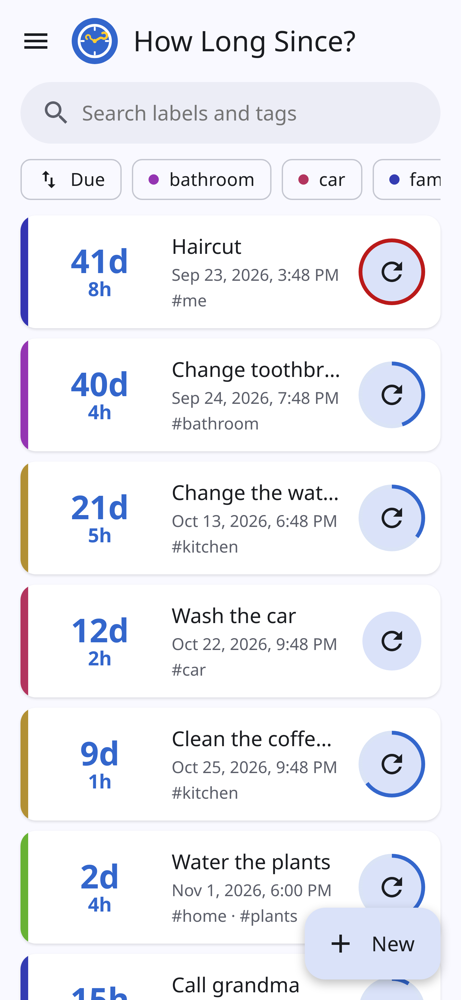
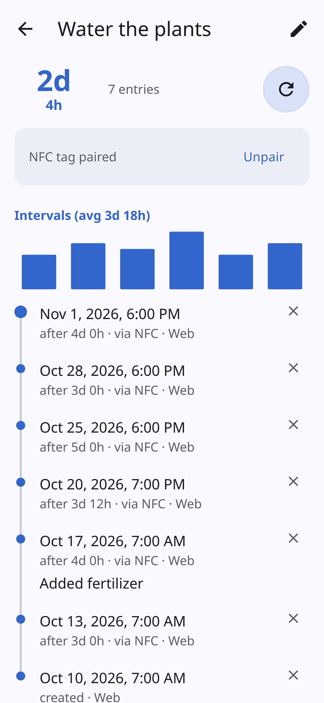
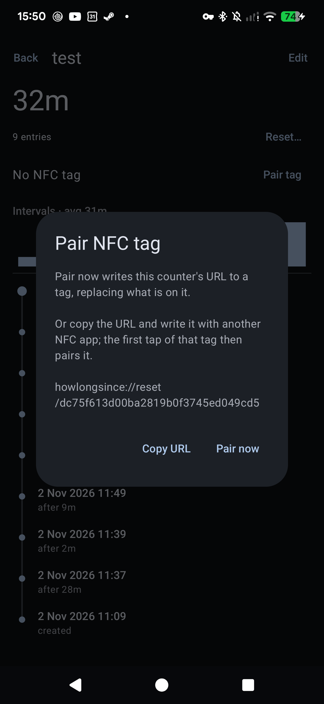
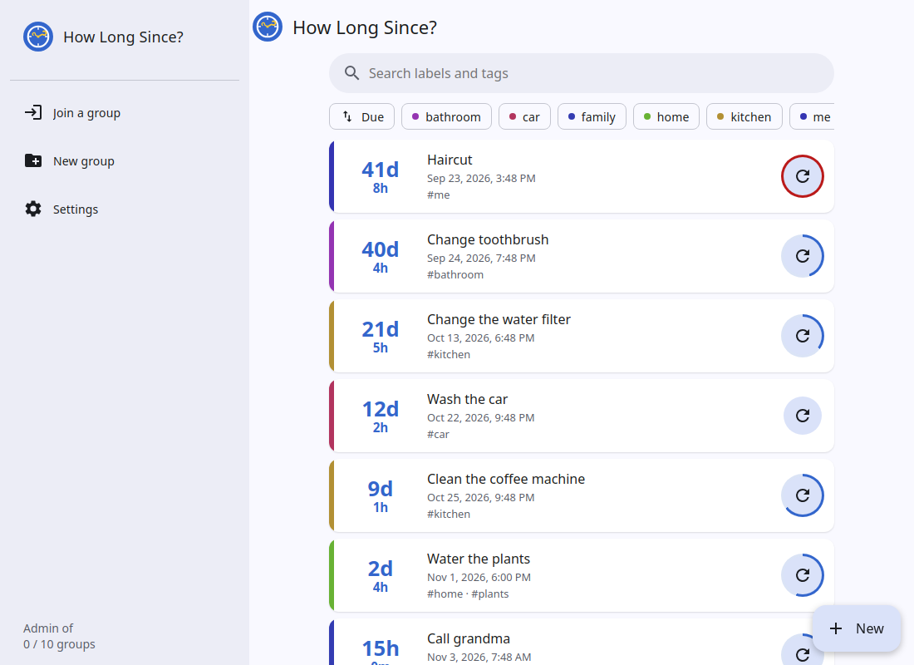

# How Long Since? – quanto tempo è passato dall'ultima volta

[English](README.md) | **Italiano**


**How Long Since?** è un'app gratuita e open source per Android e per il web che risponde a una domanda: *quanto tempo è passato dall'ultima volta che…?* Hai annaffiato le piante, cambiato lo spazzolino, pulito la macchina del caffè, tagliato i capelli, chiamato la nonna, cambiato il filtro dell'acqua. Un tocco quando lo fai, e l'app conta i giorni per te.

- **Semplice**: una scheda per ogni cosa, che mostra "12 giorni" dall'ultima volta.
- **Promemoria**: una notifica quando qualcosa è fermo da troppo.
- **Tag NFC**: attacca un tag al vaso o al filtro e toccalo con il telefono per registrarlo, anche ad app chiusa.
- **Storico e statistiche**: ogni volta viene registrata, con gli intervalli tra una e l'altra e la tua media.
- **Condiviso con famiglia o coinquilini**: metti i contatori in un gruppo e sincronizzali tra telefoni e una web app in qualsiasi browser.
- **Privata per progettazione**: i gruppi sincronizzati sono cifrati end-to-end. Il server non può leggere i tuoi contatori.
- **Gratuita e open source** (GPL-3.0), niente pubblicità, niente account, niente tracciamento. Usa il server pubblico o ospita il tuo.

 

## Funzionalità

- **Contatori**: ognuno ha un'etichetta e dei tag separati da virgole. Le schede mostrano il tempo trascorso con un numero grande e sotto la data dell'ultimo azzeramento.
- **Registro degli azzeramenti**: ogni creazione o azzeramento viene salvato, marcato `create`, `manual` o `nfc`. La pagina di dettaglio di un contatore mostra il registro come una timeline con l'intervallo tra un azzeramento e l'altro, e un piccolo grafico a barre degli intervalli recenti e della loro media.
- **Azzeramento nel passato**: "Reset at…" nella pagina di dettaglio, per quando ti sei dimenticato di registrarlo.
- **Note**: "Reset…" nella pagina di dettaglio accetta una nota opzionale (es. "nuova marca di filtro"), mostrata nella timeline.
- **Annulla**: ogni azzeramento mostra uno snackbar "Undo", e Undo rimuove quella voce dal registro.
- **Promemoria**
  - Imposta facoltativamente "notify after" in ore, giorni o settimane (o minuti in modalità Debug). "Usa la mia media" lo imposta sul tuo intervallo medio tra gli azzeramenti.
  - Un anello attorno al pulsante di azzeramento si riempie man mano che si avvicina il promemoria e diventa rosso quando è scaduto. I contatori in ritardo compaiono per primi.
  - Toccando la notifica si apre la pagina del contatore. I suoi pulsanti azzerano il contatore o rimandano di un giorno.
- **Tag NFC**
  - Abbina un tag dalla pagina di dettaglio del contatore. L'app scrive `howlongsince://reset/<uuid>` (l'id di sincronizzazione del contatore, così il tag funziona su ogni telefono del gruppo) sul tag e ne ricorda l'ID.
  - Toccare il tag azzera il contatore, anche ad app chiusa. I tag non abbinati vengono rifiutati, e Unpair o Re-pair fanno smettere di funzionare un vecchio tag.
  - Oppure "Copy URL" e scrivi il tag con qualsiasi altra app NFC; il primo tocco di quel tag lo abbina.

  

- **Archivio**: nasconde un contatore senza perderne la storia; i contatori archiviati non hanno promemoria e stanno dietro il chip "Archived".
- **Ricerca, ordinamento e tag**: cerca tra etichette e tag; ordina per più in ritardo, azzerati di recente o nome; filtra per tag, ognuno con un colore fisso.
- **Widget per la schermata Home**: i contatori che più hanno bisogno di un azzeramento, ognuno con il suo pulsante. I tempi si aggiornano a ogni modifica e ogni 30 minuti.
- **Scorciatoie del launcher**: tieni premuta l'icona dell'app per azzerare i 4 contatori che ne hanno più bisogno.
- **Gruppi e sincronizzazione**: vedi [Gruppi](#gruppi).
- **Esporta e importa**: un file JSON, controllato prima che venga sovrascritto qualcosa. "Sostituisci" scambia i gruppi con lo stesso nome con quelli del file, "Tieni entrambi" li importa come nuovi gruppi. Lo stesso file funziona sul telefono e sul web.
- **Impostazioni** (menu ☰): tema scuro (segue il sistema finché non lo cambi), modalità Debug (promemoria in minuti).
- **Lingue**: inglese e italiano, secondo la lingua del telefono o del browser. Da Android 13 la lingua dell'app si può anche impostare a parte (Impostazioni → App → How Long Since? → Lingua).
- **Aspetto**: Material 3 con i colori del tuo sfondo (Android 12+) e una barra del titolo grande che si riduce scorrendo.

### Web app



Ogni gruppo sincronizzato si può aprire anche in un browser all'indirizzo del server (per esempio [howlongsince.etrunon.eu](https://howlongsince.etrunon.eu)). La web app fa tutto quello che fa il telefono tranne l'abbinamento NFC, i promemoria e le notifiche, e il widget. I contatori possono anche vivere solo nel browser ("Senza gruppo", salvati nel suo local storage).

Si può installare come app, con finestra e icona proprie:
- Chrome / Chromium / Edge (qualsiasi OS): l'icona di installazione a destra della barra degli indirizzi.
- Firefox su Windows (143+): l'icona "aggiungi alla barra delle applicazioni" nella barra degli indirizzi. Se manca, imposta `browser.taskbarTabs.enabled` a `true` in `about:config`.
- Firefox su Android: menu → "Aggiungi a schermata Home".
- Firefox su Linux: nessuna opzione di installazione; usa una scheda fissata o Chromium.

La web app tiene chiavi e token nel `localStorage` del browser: cancellare i dati del sito li perde, insieme ai contatori Senza gruppo. "Copia link" salva un gruppo; Esporta salva i Senza gruppo.

## Privacy prima di tutto

I contatori che non sono in un gruppo sincronizzato non lasciano mai il telefono (o il browser). Quando sincronizzi un gruppo, è **cifrato end-to-end**: il telefono o il browser lo cifra prima di inviarlo, e solo i dispositivi che hanno la chiave del gruppo possono decifrarlo. Il server salva un blob che non può leggere e non unisce nulla: tutte le unioni avvengono sui tuoi dispositivi.

**Il server non può leggere**:
- etichette, tag, note dei contatori e id dei tag NFC;
- il nome del gruppo e i nomi dei dispositivi;
- quale dispositivo ha registrato ogni azzeramento.

**Il server non può modificare** nulla senza che si veda: l'intero documento porta un MAC fatto con la chiave del gruppo, quindi le app rifiutano un blob manomesso. Quello che un server può ancora fare è rifiutarsi di servire un gruppo, eliminarlo, o servirne una copia più vecchia (che potrebbe riportare indietro un contatore eliminato di recente).

**Il server può leggere** (questi metadati restano in chiaro perché il server possa contare i gruppi attivi e ripulire quelli abbandonati):
- quanti contatori ha un gruppo, e i loro id casuali;
- quando ogni contatore è stato azzerato, al secondo, e se è stato un azzeramento `create`, `manual` o `nfc`;
- l'intervallo del promemoria di ogni contatore, se è archiviato o eliminato, e quando è stato modificato l'ultima volta;
- i dispositivi del gruppo: id casuali, ruolo (amministratore o membro), quando sono entrati e quando hanno sincronizzato l'ultima volta;
- la dimensione del blob, quando sincronizzi e il tuo indirizzo IP.

Quindi il gestore del server potrebbe vedere che "un contatore di un gruppo viene azzerato circa ogni 3 giorni con un tag NFC", ma non di cosa si tratta.

**Chiavi e password**:
- Ogni gruppo ha un segreto casuale di 32 byte creato sul dispositivo che l'ha creato. Viaggia solo dentro il link di condivisione, dopo il `#`, una parte che i browser non inviano mai al server.
- La password di recupero non lascia mai il dispositivo: viene inviato solo un suo hash lento e con sale (PBKDF2, 600 000 iterazioni), e il server salva un hash di quello.
- Ogni dispositivo riceve un proprio token di accesso; il server ne salva solo l'hash.
- Su Android, chiavi e token stanno in un file che i backup saltano.

I dettagli tecnici sono in [Come funziona la sincronizzazione](#come-funziona-la-sincronizzazione).

## Gruppi

Un **gruppo** è un insieme di contatori che si sincronizza, o no, per conto suo. La schermata Home mostra una sezione comprimibile per gruppo; il menu ☰ apre un singolo gruppo. I contatori senza gruppo restano sul dispositivo.

- **Crea e sincronizza**: ☰ → Gruppi → tocca un gruppo, inserisci l'URL di un server (quello pubblico è proposto di default) e una password di recupero, e attiva la sincronizzazione. Quel dispositivo diventa **amministratore** del gruppo.
- **Condividi**: su un gruppo sincronizzato, l'icona condividi dà a un amministratore un link e un codice QR. Contengono l'indirizzo del server, la chiave del gruppo e un invito monouso valido 24 ore. Su un altro telefono apri Gruppi → Unisciti e incolla il link, oppure aprilo e basta (o inquadra il codice QR con la fotocamera): apre l'app o la web app.
- **Membri**: chi entra con un invito è un **membro**. I membri vedono e modificano tutti i contatori del gruppo e sincronizzano normalmente, ma non possono invitare né revocare.
- **Amministratori**: vedono i dispositivi del gruppo e possono revocarli. Un dispositivo revocato smette di sincronizzare ma tiene ciò che ha già; per escludere qualcuno del tutto, crea un nuovo gruppo e spostaci i contatori.
- **Password di recupero**: insieme al link del gruppo, fa entrare un nuovo dispositivo come amministratore, anche se ogni altro dispositivo è perso. Un membro che la conosce diventa amministratore inserendola. Conserva in un posto sicuro il link (il Condividi di un membro lo mostra senza invito) e la password: chi li ha entrambi è amministratore, e la password non si può reimpostare.
- **Spostare contatori**: la finestra di modifica di un contatore lo sposta in un altro gruppo; oppure tieni premuto un contatore per selezionarne più d'uno, poi tocca la freccia. Un contatore spostato sparisce dal vecchio gruppo per tutti, e il suo tag NFC continua a funzionare.
- **Eliminare un gruppo** chiede se i suoi contatori su questo dispositivo passano a "Senza gruppo" o vengono eliminati. Lasciare un gruppo rimuove questo dispositivo; il gruppo viene eliminato dal server quando non resta nessun dispositivo.

Buono a sapersi:
- Gli azzeramenti non vanno mai persi, anche quando due telefoni azzerano nello stesso istante. Due azzeramenti dello stesso contatore nello stesso secondo contano come uno.
- Le modifiche valgono per l'intero contatore: la modifica più recente sostituisce insieme etichetta, tag e promemoria, quindi se due persone cambiano campi diversi quasi nello stesso momento, una delle due modifiche va persa. "Più recente" usa l'orologio di ogni telefono.
- I promemoria scattano su ogni telefono che ha il contatore, e un tag abbinato su un telefono funziona su tutti.
- L'app si sincronizza all'apertura, poco dopo ogni modifica e ogni 15 minuti in background. La web app si sincronizza ogni 15 minuti e quando la sua scheda torna visibile.

## Limite di amministrazione per dispositivo

Per mantenere equo un server condiviso, ogni dispositivo può essere **amministratore di al massimo 10 gruppi per server** (un server ospitato da te può cambiarlo con `MAX_ADMIN_GROUPS`). Un dispositivo diventa amministratore creando un gruppo o inserendo la password di recupero di un gruppo, ed entrambi contano. Entrare come membro con un invito non conta: un dispositivo può essere membro di quanti gruppi vuole.

- Il limite è per dispositivo e per server: un telefono e un browser sono dispositivi diversi, e i gruppi su un altro server hanno il loro limite.
- Il menu ☰ (app) e la barra laterale (web) mostrano "Amministratore di X / N gruppi" per ogni server.
- Raggiunto il limite, creare un gruppo o diventarne amministratore viene rifiutato con "Sei già amministratore di tutti i gruppi che questo server consente". Lascia o elimina un gruppo che amministri per fare spazio.

Il server limita anche quanti gruppi un indirizzo IP può creare all'ora (10 di default) e il numero totale di gruppi (10 000 di default), ed elimina i gruppi non sincronizzati da un anno (sei mesi se hanno meno di 3 contatori).

## Ospitare il tuo server

Il server in `server/` è un piccolo programma Go che salva ogni gruppo sincronizzato come un file cifrato e serve la web app. L'immagine Docker è un singolo binario di circa 8 MB. Le app funzionano con qualsiasi server: quando crei un gruppo, scegli un server personalizzato invece di quello pubblico, e il link di condivisione porta tutti sul server che indica.

**Requisiti**: una macchina con Docker, un nome di dominio, e HTTPS con un certificato di cui Android si fida di default (Let's Encrypt, Tailscale, una CA commerciale). I certificati autofirmati o di una CA privata installati sul telefono non sono accettati dall'app, e la web app richiede https (o localhost) per la crittografia del browser.

**Avvio**
```bash
git clone https://github.com/Etrunon/HowLongSince.git
cd HowLongSince/server
echo HLS_TOKEN=$(openssl rand -hex 16) > .env   # facoltativo: per GET /stats e per i gruppi creati prima dei token per dispositivo
mkdir -p data                                   # deve essere scrivibile dall'uid 1000
docker compose up -d --build                    # in ascolto su 127.0.0.1:13387
```
Metti davanti un reverse proxy con HTTPS. Il server parla solo HTTP semplice; il proxy gestisce il certificato, limita i tentativi di indovinare il token e aggiunge gli header di sicurezza per il browser. nginx fa tutto questo senza plugin:
```nginx
# nel blocco http {}
limit_req_zone $binary_remote_addr zone=hls:1m rate=30r/m;

server {
    listen 443 ssl;
    server_name hls.example.com;
    ssl_certificate     /etc/letsencrypt/live/hls.example.com/fullchain.pem;
    ssl_certificate_key /etc/letsencrypt/live/hls.example.com/privkey.pem;

    client_max_body_size 10m;                          # il default di nginx (1 MB) è sotto il limite del server
    proxy_set_header X-Forwarded-For $remote_addr;     # i limiti per IP leggono questo

    add_header Strict-Transport-Security "max-age=31536000" always;
    add_header X-Content-Type-Options nosniff always;
    add_header Referrer-Policy no-referrer always;
    add_header Content-Security-Policy "default-src 'self'; connect-src 'self' https:; script-src 'self' 'unsafe-inline'; style-src 'self' 'unsafe-inline'; frame-ancestors 'none'" always;

    location /s/ {
        limit_req zone=hls burst=20 nodelay;   # ~30 sync/min per IP, picchi consentiti
        proxy_pass http://127.0.0.1:13387;
    }
    location / {
        proxy_pass http://127.0.0.1:13387;
    }
}
```
Con Caddy, gli stessi header vanno in un blocco `header`; il rate limiting richiede il plugin `caddy-ratelimit`. Lascia `connect-src 'self' https:` nella CSP: senza, la web app su questo server non può sincronizzare gruppi su un altro. Il server risponde da sé alle richieste cross-origin (CORS), quindi il proxy non deve fare nulla per questo. Lo stesso per la compressione: il server comprime le risposte con gzip e accetta corpi delle richieste compressi (`Content-Encoding: gzip`), quindi lascia spenta la compressione del proxy. Le app inviano sempre gzip, quindi serve un server recente almeno quanto loro. `tailscale serve` fornisce HTTPS ma non può aggiungere header né limiti, il che va bene quando il server è raggiungibile solo dalla tua tailnet.

Poi apri `https://hls.example.com` per la web app, o inserisci quell'URL nel telefono (Gruppi → tocca un gruppo → URL del server).

**Configurazione** (variabili d'ambiente): `TOKEN` (facoltativo: rivendica i gruppi creati prima dei token per dispositivo, e legge `/stats`), `CREATES_PER_IP_HOUR` (predefinito 10), `MAX_GROUPS` (predefinito 10000), `MAX_ADMIN_GROUPS` (predefinito 10, vedi [Limite di amministrazione per dispositivo](#limite-di-amministrazione-per-dispositivo); rifiutato con 402), `DATA_DIR` (predefinito `/data`, i blob vanno in `s/` al suo interno), `ADDR` (predefinito `:8080`). `compose.yml` collega `HLS_TOKEN` e `HLS_MAX_ADMIN_GROUPS` da `.env` a `TOKEN` e `MAX_ADMIN_GROUPS`. Chiunque può creare un gruppo, entro questi limiti. I limiti per IP leggono l'ultimo indirizzo di `X-Forwarded-For`, che imposta il reverse proxy. Il server chiude le connessioni lente o bloccate (10 s per inviare gli header, 30 s per richiesta) e scrive i blob in modo atomico.

**Backup**: tutto lo stato è la cartella `data/`. Basta copiarla; contiene solo blob cifrati e hash.

**Aggiornare dal `TOKEN` condiviso**: lascia `TOKEN` impostato. Ogni dispositivo ci rivendica il proprio token alla prima sincronizzazione, come membro; il primo che inserisce una password di recupero (web: la chiede; telefono: tocca il gruppo) diventa amministratore, e da lì `TOKEN` non apre più quel gruppo. Quando tutti i gruppi sono rivendicati, `TOKEN` serve solo per `/stats`.

### API

`{id}` sono 32 caratteri esadecimali derivati dal segreto del gruppo; "dispositivo" significa il token del dispositivo come `Authorization: Bearer`.
- `GET /` web app, `GET /health` risponde `ok`, `GET /limits` restituisce `{"maxAdminGroups": N}`, `GET /stats` (con `TOKEN`) restituisce i totali: gruppi, dispositivi, contatori attivi, azzeramenti negli ultimi 7 e 30 giorni.
- `GET /s/{id}` (dispositivo) restituisce `{etag, ciphertext}`. `PUT /s/{id}` (dispositivo) riceve `{ciphertext}` e `If-Match: <etag>`, e risponde 409 se qualcun altro ha scritto prima. Senza `If-Match` crea il gruppo: `{ciphertext, deviceId, recovery}`, senza token, restituisce `{etag, token}` e chi chiama è amministratore.
- `POST /s/{id}/invite` (amministratore) restituisce `{nonce}`, monouso, 24 h. `POST /s/{id}/enroll {deviceId, nonce}` crea un membro, `{deviceId, recovery}` un amministratore; entrambi restituiscono `{token}`. `POST /s/{id}/promote {recovery}` (dispositivo) rende amministratore chi chiama. `POST /s/{id}/recovery {recovery}` (amministratore) cambia la password.
- `GET /s/{id}/devices` (amministratore) elenca `{id, admin, created, lastSeen}`. `POST /s/{id}/revoke {deviceId}` (amministratore). `POST /s/{id}/leave` (dispositivo); il gruppo viene eliminato quando non resta nessun dispositivo.
- `POST /s/{id}/claim {deviceId}` (con `TOKEN`, solo gruppi senza password di recupero) restituisce un `{token}` da membro.
- `recovery` è PBKDF2-HMAC-SHA256 della password, con `{id}` come sale, 600 000 iterazioni, in base64. Il server salva lo SHA-256 di questo valore e di ogni token, e ammette 5 password errate per gruppo all'ora e 20 errori per IP all'ora.

### Come funziona la sincronizzazione

- La chiave: HKDF-SHA256 trasforma il segreto casuale di 32 byte del gruppo nell'id che vede il server e in una chiave AES-256-GCM.
- Il blob (formato v4) è JSON: ogni contatore porta i propri azzeramenti, e un azzeramento è identificato dal suo contatore e dal suo orario, salvato al secondo. Etichette, tag, id NFC, note, e nomi di gruppi e dispositivi sono cifrati uno per uno con AES-GCM (autenticati con id del gruppo, id del record e nome del campo). Quale dispositivo ha registrato ogni azzeramento è cifrato una volta sola per tutto il documento, come un'unica lista (`who`). Il resto è leggibile: id dei contatori e dei dispositivi, `updatedAt`, `deleted`, `archived`, intervalli dei promemoria, orari e origini degli azzeramenti. L'intero documento viaggia come un'unica stringa con un MAC (SHA-256 dei suoi byte esatti, sigillato con la chiave). Il server salva ogni blob compresso con gzip.
- Una sincronizzazione è: scarica il blob, decifra, unisci con il gruppo locale, cifra, rimettilo con `If-Match`; con un 409 ricomincia.
- I contatori hanno un UUID; il telefono mantiene i suoi id locali per i promemoria, e i tag NFC contengono l'UUID. Modifiche ai contatori: vince l'`updatedAt` più recente. Gli azzeramenti vengono uniti per contatore e orario. Spostare un contatore mantiene il suo UUID e scrive un tombstone nel vecchio gruppo.
- Le eliminazioni sono tombstone (`deleted: true`), così raggiungono ogni dispositivo. Vengono rimosse definitivamente dopo 90 giorni; un dispositivo offline più a lungo, o un server che serve un blob vecchio, potrebbe riportarne indietro una.
- Accanto al blob il server tiene, senza mai inviarli ai client, i dispositivi del gruppo (id, hash del token, ruolo, creazione, ultimo accesso), gli inviti aperti, l'hash di recupero e quando è stato sincronizzato l'ultima volta (aggiornato al massimo una volta all'ora).
- Ogni sincronizzazione trasporta lo stato completo del gruppo, il che va bene per pochi telefoni e centinaia di contatori (le richieste sono limitate a 10 MB dopo la decompressione).
- Si legge solo il formato v4: app e server precedenti non aprono i gruppi v4, e quelli nuovi non aprono i gruppi più vecchi.

## Contribuire

Segnalazioni di bug, idee e pull request sono benvenute.

1. Per qualsiasi cosa più grande di una piccola correzione apri prima una [issue](https://github.com/Etrunon/HowLongSince/issues), così ci mettiamo d'accordo sull'approccio.
2. Fai un fork del repository e crea un branch da `main`.
3. Fai la modifica. Tienila piccola e nello stile del codice intorno: pochi file, nessuna nuova dipendenza se non davvero necessaria.
4. Esegui i test (vedi sotto) e prova la modifica su un telefono o nel browser.
5. Se la modifica cambia ciò che vedono gli utenti o come funziona il server, aggiorna **entrambi** `README.md` e `README-IT.md` nello stesso commit: devono sempre dire la stessa cosa. Ogni nuovo testo visibile all'utente richiede una stringa in inglese e una in italiano (`app/src/main/res/values*/strings.xml`, e le tabelle `T` in `server/web/app.js`).
6. Apri una pull request verso `main` descrivendo cosa è cambiato e perché, con uno screenshot per le modifiche all'interfaccia.

### Compilazione e test

Richiede JDK 21 (Gradle 8.11 non funziona con JDK più recenti) e l'Android SDK. Imposta `sdk.dir` in `local.properties`, oppure `ANDROID_HOME`.

```bash
export JAVA_HOME=/usr/lib/jvm/java-21-openjdk-amd64
./gradlew test                    # test unitari Android
./gradlew installDebug            # compila e installa su un telefono collegato (debug USB attivo)
node --test server/web.test.mjs   # test della logica della web app
cd server && go test ./...        # test del server (girano anche durante il docker build)
```

L'NFC richiede un telefono vero e tag NDEF scrivibili (per esempio NTAG213/215/216).

**Tecnologia**: Kotlin e Jetpack Compose (Material 3) in una sola Activity, Android 8.0 (API 26) o successivo. **Room** salva le tabelle `Counter` ed `Event`; il tempo trascorso viene calcolato dall'ultimo `Event` e mai salvato. **WorkManager** esegue un job di promemoria ritardato per ogni contatore. L'**API NFC di Android** (record URI NDEF, reader mode durante l'abbinamento). Le librerie integrate `org.json` e `HttpURLConnection` per esportazione, importazione e sincronizzazione. Il server è in Go senza dipendenze oltre la libreria standard; la web app è JavaScript semplice senza build.

### Struttura del codice

```
app/src/main/java/eu/etrunon/howlongsince/
  Data.kt          Entità Room, query al database, formattazione di tempi e tag
  MainActivity.kt  Schermata elenco, finestra di modifica, impostazioni, gestione degli intent di notifiche e NFC
  Detail.kt        Schermata di dettaglio: timeline, grafico degli intervalli, abbinamento NFC
  Notify.kt        Pianificazione dei promemoria e worker delle notifiche
  Nfc.kt           Scrittura dei tag e lettura dell'URI di azzeramento
  Export.kt        Esportazione, importazione e ripristino JSON
  Sync.kt          Sincronizzazione col server: formato JSON, unione e chiamate HTTP
  Crypto.kt        Derivazione delle chiavi e cifratura di un gruppo
  Groups.kt        Schermata Gruppi: crea, rinomina, elimina, sincronizza e condividi
  Join.kt          Link di condivisione, codice QR e unione a un gruppo
  Widget.kt        Widget per la schermata Home
  Theme.kt         Tema a colori dinamici e colori dei tag
app/src/test/.../SinceTest.kt  Test unitari (formattazione, tag, ritardo dei promemoria, URI NFC, andata e ritorno JSON di backup e sync)
server/
  main.go          Server di sincronizzazione: archivio di blob cifrati e handler HTTP
  main_test.go     Test dell'archivio dei blob (eseguito durante il docker build)
  web.test.mjs     Test della logica della web app
  web/             Web app (index.html, style.css, core.js, app.js), inclusa nel binario del server
  Dockerfile, compose.yml
logo.svg           Logo (l'icona dell'app e la favicon web derivano da qui)
```

## Licenza

GPL-3.0, vedi [LICENSE](LICENSE). Puoi usarlo, modificarlo e condividerlo; le modifiche condivise devono restare sotto GPL.
