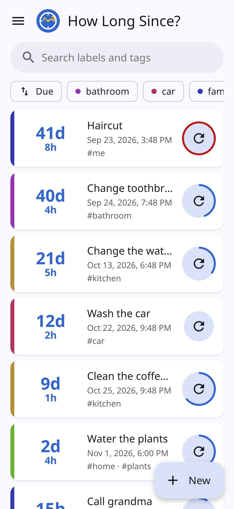
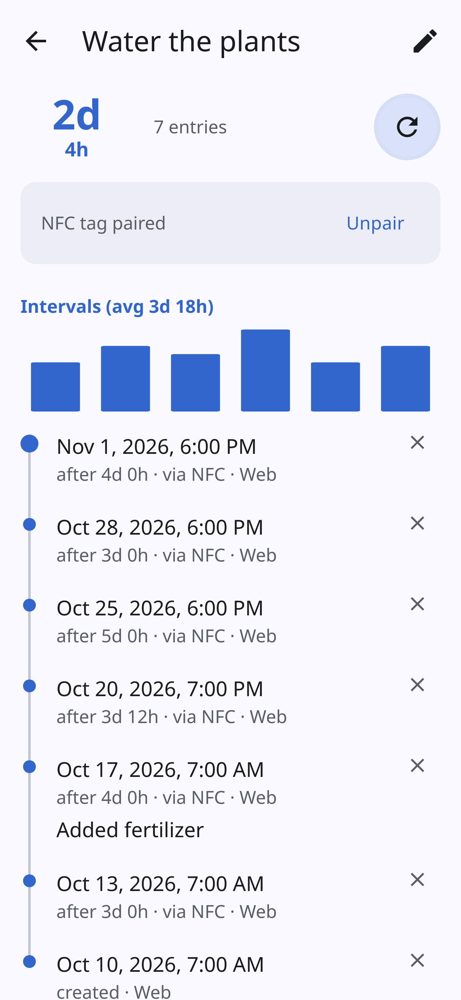
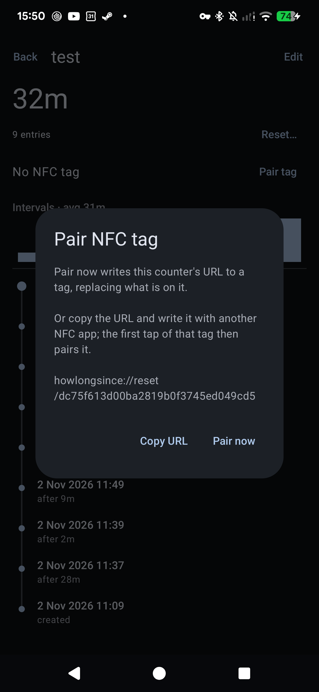

# How Long Since? – track when you last did anything

**English** | [Italiano](README-IT.md)


**How Long Since?** is a free, open-source app for Android and the web that answers one question: *how long has it been since I last…?* Watered the plants, changed the toothbrush, cleaned the coffee machine, had a haircut, called grandma, changed the water filter. Tap once when you do it, and the app counts the days for you.

- **Simple**: one card per thing, showing "12 days" since the last time.
- **Reminders**: get a notification when something has gone too long.
- **NFC tags**: stick a tag on the plant pot or the filter and tap it with your phone to log it, even with the app closed.
- **History and stats**: every time is logged, with the gaps between them and your average.
- **Shared with family or flatmates**: put counters in a group and sync them between phones and a web app in any browser.
- **Private by design**: synced groups are end-to-end encrypted. The server can't read your counters.
- **Free and open source** (GPL-3.0), no ads, no account, no tracking. Use the public server or host your own.

**Website: [howlongsince.etrunon.eu](https://howlongsince.etrunon.eu)** · **Web app: [howlongsince.etrunon.eu/app](https://howlongsince.etrunon.eu/app/)**

 

## Features

- **Counters**: each has a label and comma-separated tags. Cards show the elapsed time as a large number with the date of the last reset underneath.
- **Reset log**: every create or reset is stored, marked `create`, `manual` or `nfc`. A counter's detail page shows the log as a timeline with the gap between resets, and a small bar chart of the recent intervals and their average.
- **Reset at a past time**: "Reset at…" on the detail page, for when you forgot to log it.
- **Notes**: "Reset…" on the detail page takes an optional note (e.g. "new filter brand"), shown in the timeline.
- **Undo**: every reset shows an "Undo" snackbar, and Undo removes that log entry.
- **Reminders**
  - Optionally set "notify after" in hours, days or weeks (or minutes in Debug mode). "Use my average" sets it to your average interval between resets.
  - A ring around the reset button fills up as the reminder gets closer and turns red when overdue. Overdue counters are listed first.
  - Tapping the notification opens that counter's page. Its buttons reset the counter or snooze for a day.
- **NFC tags**
  - Pair a tag from the counter's detail page. The app writes `howlongsince://reset/<uuid>` (the counter's sync id, so the tag works on every phone in the group) to the tag and remembers the tag's ID.
  - Tapping the tag resets the counter, even when the app is closed. Tags that aren't paired are rejected, and Unpair or Re-pair makes an old tag stop working.
  - Or "Copy URL" and write the tag with any other NFC app; the first tap of that tag then pairs it.

  

- **Archive**: hide a counter without losing its history; archived counters have no reminders and sit behind an "Archived" chip.
- **Search, sort and tags**: search labels and tags; sort by most overdue, recently reset or name; filter by tag, each with a stable color.
- **Home-screen widget**: the counters most in need of a reset, each with a reset button. Times refresh on every change and every 30 minutes.
- **Launcher shortcuts**: long-press the app icon to reset the 4 counters that need it most.
- **Groups and sync**: see [Groups](#groups).
- **Export and import**: a JSON file, checked before anything is overwritten. "Replace" swaps the groups of the same name for the file's, "Keep both" imports them as new groups. The same file works on the phone and the web.
- **Settings** (☰ menu): dark theme (follows the system until you change it), Debug mode (minute-based reminders).
- **Languages**: English and Italian, following the phone or browser language. On Android 13+ the app's language can also be set on its own (Settings → Apps → How Long Since? → Language).
- **Look**: Material 3 with colors from your wallpaper (Android 12+) and a large title bar that collapses as you scroll.

### Web app


Every synced group can also be opened in a browser at the server's address (for example [howlongsince.etrunon.eu/app](https://howlongsince.etrunon.eu/app/)). The web app does everything the phone does except NFC pairing, reminders and notifications, and the widget. Counters can also live only in the browser ("Ungrouped", kept in its local storage).

It can be installed as an app with its own window and icon:
- Chrome / Chromium / Edge (any OS): the install icon on the right of the address bar.
- Firefox on Windows (143+): the "add to taskbar" icon in the address bar. If missing, set `browser.taskbarTabs.enabled` to `true` in `about:config`.
- Firefox on Android: menu → "Add to Home screen".
- Firefox on Linux: no install option; use a pinned tab or Chromium.

The web app keeps keys and tokens in the browser's `localStorage`: clearing site data loses them, along with Ungrouped counters. "Copy link" backs up a group; Export backs up Ungrouped.

## Privacy first

Counters that aren't in a synced group never leave your phone (or your browser). When you sync a group, it is **end-to-end encrypted**: the phone or the browser encrypts it before sending it, and only devices that have the group's key can decrypt it. The server stores a blob it can't read and merges nothing: all merging happens on your devices.

**The server can't read**:
- counter labels, tags, notes and NFC tag ids;
- the group's name and the devices' names;
- which device logged each reset.

**The server can't change** anything unnoticed: the whole document carries a MAC made with the group's key, so a tampered blob is rejected by the apps. What a server can still do is refuse to serve a group, delete it, or serve an older copy of it (which could bring back a recently deleted counter).

**The server can read** (this metadata is kept in the clear so the server can count active groups and clean up abandoned ones):
- how many counters a group has, and their random ids;
- when each counter was reset, to the second, and whether it was a `create`, `manual` or `nfc` reset;
- each counter's reminder interval, whether it is archived or deleted, and when it was last edited;
- the group's devices: random ids, role (admin or member), when they joined and when they last synced;
- the size of the blob, when you sync, and your IP address.

So the server operator could see that "some counter in some group is reset about every 3 days from an NFC tag", but not what it is.

**Keys and passwords**:
- Each group has a random 32-byte secret made on the device that created it. It travels only inside the share link, after the `#`, a part that browsers never send to the server.
- Your recovery password never leaves the device: only a slow, salted hash of it (PBKDF2, 600 000 rounds) is sent, and the server stores a hash of that.
- Each device gets its own access token; the server stores only its hash.
- On Android, keys and tokens are kept in a file that backups skip.

Technical details are in [How sync works](#how-sync-works).

## Groups

A **group** is a set of counters that is synced, or not, on its own. The home screen shows one foldable section per group; the ☰ menu opens a single group. Counters without a group stay on the device.

- **Create and sync**: ☰ → Groups → tap a group, enter a server URL (the public one is offered by default) and a recovery password, and turn sync on. That device becomes the group's **admin**.
- **Share**: on a synced group, the share icon gives an admin a link and a QR code. They hold the server address, the group's key and a single-use invite valid for 24 hours. On another phone, open Groups → Join and paste the link, or simply open it (or scan the QR code with the camera): it opens the app or the web app.
- **Members**: whoever joins with an invite is a **member**. Members see and edit all the group's counters and sync normally, but can't invite or revoke.
- **Admins** see the group's devices and can revoke any of them. A revoked device stops syncing but keeps what it already has; to cut someone off completely, make a new group and move the counters into it.
- **Recovery password**: together with the group link, it joins a new device as an admin, even if every other device is lost. A member who knows it becomes admin by entering it. Keep the link (a member's Share shows it without an invite) and the password somewhere safe: anyone who has both is an admin, and the password can't be reset.
- **Moving counters**: a counter's edit dialog moves it to another group; or long-press a counter to select several, then tap the arrow. A moved counter disappears from the old group for everyone, and its NFC tag keeps working.
- **Deleting a group** asks whether its counters on this device move to "Ungrouped" or are deleted. Leaving a group removes this device; the group is deleted from the server when no device is left.

Good to know:
- Resets are never lost, even when two phones reset at the same moment. Two resets of the same counter in the same second count as one.
- Edits are whole-counter: the most recent edit replaces label, tags and reminder together, so if two people change different fields at almost the same time, one change is lost. "Most recent" uses each phone's clock.
- Reminders fire on every phone that has the counter, and a tag paired on one phone works on all of them.
- The app syncs when it opens, shortly after every change, and every 15 minutes in the background. The web app syncs every 15 minutes and when its tab comes back into view.

## Admin limit per device

To keep a shared server fair, each device can be **admin of at most 10 groups per server** (a self-hosted server can change this with `MAX_ADMIN_GROUPS`). A device becomes admin by creating a group or by entering a group's recovery password, and both count. Joining as a member with an invite doesn't count: a device can be a member of any number of groups.

- The limit is per device and per server: a phone and a browser are separate devices, and groups on another server have their own limit.
- The ☰ menu (app) and the sidebar (web) show "Admin of X / N groups" for each server.
- When the limit is reached, creating a group or becoming admin is refused with "You are already admin of as many groups as this server allows". Leave or delete a group you administer to make room.

The server also caps how many groups an IP address can create per hour (10 by default) and the total number of groups (10 000 by default), and deletes groups that haven't synced for a year (half a year if they have fewer than 3 counters).

## Host your own server

The server in `server/` is a small Go program that stores each synced group as one encrypted file, and serves the website at `/` and the web app at `/app/`. The Docker image is a single binary of about 8 MB. The apps work with any server: when creating a group, choose a custom server instead of the public one, and the share link takes everyone to the server it names.

**Requirements**: a machine with Docker, a domain name, and HTTPS with a certificate Android trusts by default (Let's Encrypt, Tailscale, a commercial CA). Self-signed or private-CA certificates installed on the phone are not trusted by the app, and the web app needs https (or localhost) for the browser's crypto.

**Run it**
```bash
git clone https://github.com/Etrunon/HowLongSince.git
cd HowLongSince/server
echo HLS_TOKEN=$(openssl rand -hex 16) > .env   # optional: for GET /stats, and for groups made before device tokens
mkdir -p data                                   # must be writable by uid 1000
docker compose up -d --build                    # listens on 127.0.0.1:13387
```
Put a reverse proxy with HTTPS in front of it. The server speaks plain HTTP only; the proxy handles the certificate, rate-limits token guessing, and adds browser security headers. nginx does all of this without plugins:
```nginx
# in the http {} block
limit_req_zone $binary_remote_addr zone=hls:1m rate=30r/m;

server {
    listen 443 ssl;
    server_name hls.example.com;
    ssl_certificate     /etc/letsencrypt/live/hls.example.com/fullchain.pem;
    ssl_certificate_key /etc/letsencrypt/live/hls.example.com/privkey.pem;

    client_max_body_size 10m;                          # nginx's default 1 MB is below the server's cap
    proxy_set_header X-Forwarded-For $remote_addr;     # the per-IP limits read this

    add_header Strict-Transport-Security "max-age=31536000" always;
    add_header X-Content-Type-Options nosniff always;
    add_header Referrer-Policy no-referrer always;
    add_header Content-Security-Policy "default-src 'self'; connect-src 'self' https:; script-src 'self' 'unsafe-inline'; style-src 'self' 'unsafe-inline'; frame-ancestors 'none'" always;

    location ~ ^(/app)?/s/ {
        limit_req zone=hls burst=20 nodelay;   # ~30 syncs/min per IP, bursts allowed
        proxy_pass http://127.0.0.1:13387;
    }
    location / {
        proxy_pass http://127.0.0.1:13387;
    }
}
```
With Caddy, the same headers go in a `header` block; rate limiting needs the `caddy-ratelimit` plugin. Keep `connect-src 'self' https:` in the CSP: without it, the web app on this server can't sync groups on another one. The server answers cross-origin requests itself (CORS), so the proxy needs nothing for that. Compression too: the server gzips its responses and accepts gzipped request bodies (`Content-Encoding: gzip`), so leave the proxy's compression off. The apps always send gzip, so they need a server at least as new as they are. `tailscale serve` gives HTTPS but can't add headers or limits, which is fine when only your tailnet can reach it.

Then open `https://hls.example.com/app/` for the web app, or enter `https://hls.example.com/app` as the server URL on the phone (Groups → tap a group → custom server).

**Configuration** (environment variables): `TOKEN` (optional: claims groups made before device tokens, and reads `/stats`), `CREATES_PER_IP_HOUR` (default 10), `MAX_GROUPS` (default 10000), `MAX_ADMIN_GROUPS` (default 10, see [Admin limit per device](#admin-limit-per-device); refused with 402), `DATA_DIR` (default `/data`, blobs go in `s/` inside it), `ADDR` (default `:8080`). `compose.yml` maps `HLS_TOKEN` and `HLS_MAX_ADMIN_GROUPS` from `.env` to `TOKEN` and `MAX_ADMIN_GROUPS`. Anyone can create a group, within those caps. The per-IP limits read the last `X-Forwarded-For` address, which the reverse proxy sets. The server drops slow or stuck connections (10 s to send headers, 30 s per request) and writes blobs atomically.

**Backups**: the whole state is the `data/` directory. Copying it is enough; it holds only encrypted blobs and hashes.

**Upgrading from the shared `TOKEN`**: keep `TOKEN` set. Each device claims its own token with it on the first sync, as a member; the first one to enter a recovery password (web: it asks; phone: tap the group) becomes admin, and from then on `TOKEN` no longer opens that group. Once every group is claimed, `TOKEN` is only needed for `/stats`.

### API

Every path below works under `/app` too, which is where the apps send new groups; the root paths stay for groups made before. `{id}` is 32 hex characters derived from the group's secret; "device" means the device's token as `Authorization: Bearer`.
- `GET /` website, `GET /app/` web app, `GET /health` returns `ok`, `GET /limits` returns `{"maxAdminGroups": N}`, `GET /stats` (with `TOKEN`) returns totals: groups, devices, live counters, resets in the last 7 and 30 days.
- `GET /s/{id}` (device) returns `{etag, ciphertext}`. `PUT /s/{id}` (device) takes `{ciphertext}` and `If-Match: <etag>`, and answers 409 if someone else wrote first. Without `If-Match` it creates the group: `{ciphertext, deviceId, recovery}`, no token needed, returns `{etag, token}` and the caller is admin.
- `POST /s/{id}/invite` (admin) returns `{nonce}`, single use, 24 h. `POST /s/{id}/enroll {deviceId, nonce}` makes a member, `{deviceId, recovery}` an admin; both return `{token}`. `POST /s/{id}/promote {recovery}` (device) makes the caller admin. `POST /s/{id}/recovery {recovery}` (admin) changes the password.
- `GET /s/{id}/devices` (admin) lists `{id, admin, created, lastSeen}`. `POST /s/{id}/revoke {deviceId}` (admin). `POST /s/{id}/leave` (device); the group is deleted when no device is left.
- `POST /s/{id}/claim {deviceId}` (with `TOKEN`, only groups without a recovery password) returns a member `{token}`.
- `recovery` is PBKDF2-HMAC-SHA256 of the password, salted with `{id}`, 600 000 rounds, base64. The server stores SHA-256 of it and of every token, and allows 5 wrong passwords per group per hour and 20 failures per IP per hour.

### How sync works

- The key: HKDF-SHA256 turns the group's random 32-byte secret into the id the server sees and an AES-256-GCM key.
- The blob (format v4) is JSON: each counter carries its own resets, and a reset is identified by its counter and its time, stored to the second. Labels, tags, NFC ids, notes, and group and device names are each sealed with AES-GCM (authenticated with the group id, record id and field name). Which device logged each reset is sealed once for the whole document, as one list (`who`). The rest is readable: counter and device ids, `updatedAt`, `deleted`, `archived`, reminder intervals, reset times and sources. The whole document travels as one string with a MAC (SHA-256 of its exact bytes, sealed with the key). The server stores each blob gzipped.
- A sync is: get the blob, decrypt, merge with the local group, encrypt, put it back with `If-Match`; on a 409 it starts again.
- Counters have a UUID; the phone keeps its local ids for reminders, and NFC tags hold the UUID. Counter edits: the newer `updatedAt` wins. Resets are merged by counter and time. Moving a counter keeps its UUID and writes a tombstone in the old group.
- Deletes are tombstones (`deleted: true`), so they reach every device. They are dropped for good after 90 days; a device offline for longer, or a server serving an old blob, could bring one back.
- Next to the blob the server keeps, never sent to clients, the group's devices (id, token hash, role, created, last seen), its open invites, the recovery hash and when it was last synced (stamped at most once an hour).
- Each sync carries the full state of the group, which is fine for a few phones and hundreds of counters (requests are capped at 10 MB after decompression).
- Only format v4 is read: older apps and servers can't open v4 groups, and the new ones can't open older groups.

## Contributing

Bug reports, ideas and pull requests are welcome.

1. Open an [issue](https://github.com/Etrunon/HowLongSince/issues) first for anything bigger than a small fix, so we can agree on the approach.
2. Fork the repository and create a branch from `main`.
3. Make the change. Keep it small and in the style of the surrounding code: few files, no new dependencies unless really needed.
4. Run the tests (see below) and try the change on a phone or in the browser.
5. If the change affects what users see or how the server works, update **both** `README.md` and `README-IT.md` in the same commit: they must always say the same thing. The same goes for the English and Italian pages of the website (`server/site/` and `server/site/it/`). New user-facing text needs both an English and an Italian string (`app/src/main/res/values*/strings.xml`, and the `T` tables in `server/web/app.js`).
6. Open a pull request against `main` describing what changed and why, with a screenshot for UI changes.

### Build and test

Requires JDK 21 (Gradle 8.11 does not run on newer JDKs) and the Android SDK. Set `sdk.dir` in `local.properties`, or set `ANDROID_HOME`.

```bash
export JAVA_HOME=/usr/lib/jvm/java-21-openjdk-amd64
./gradlew test                    # Android unit tests
./gradlew installDebug            # build and install on a connected phone (USB debugging on)
node --test server/web.test.mjs   # web app logic tests
cd server && go test ./...        # server tests (they also run during docker build)
```

NFC needs a real phone and writable NDEF tags (for example NTAG213/215/216).

**Tech**: Kotlin and Jetpack Compose (Material 3) in a single Activity, Android 8.0 (API 26) or later. **Room** stores `Counter` and `Event` tables; elapsed time is calculated from the latest `Event` and never stored. **WorkManager** runs one delayed reminder job per counter. The **Android NFC API** (NDEF URI records, reader mode while pairing). The built-in `org.json` and `HttpURLConnection` for export, import and sync. The server is Go with no dependencies beyond the standard library; the web app and the website are plain HTML, CSS and JavaScript with no build step.

### Code layout

```
app/src/main/java/eu/etrunon/howlongsince/
  Data.kt          Room entities, database queries, time and tag formatting helpers
  MainActivity.kt  List screen, edit dialog, settings, handling of notification and NFC intents
  Detail.kt        Detail screen: timeline, interval chart, NFC pairing
  Notify.kt        Reminder scheduling and the notification worker
  Nfc.kt           Tag writing and reading of the reset URI
  Export.kt        JSON export, import and restore
  Sync.kt          Sync with the server: JSON format, merge and the HTTP calls
  Crypto.kt        Key derivation and encryption of a group
  Groups.kt        Groups screen: create, rename, delete, sync and share
  Join.kt          Share link, QR code and joining a group
  Widget.kt        Home-screen widget
  Theme.kt         Dynamic color theme and tag colors
app/src/test/.../SinceTest.kt  Unit tests (formatting, tags, reminder delay, NFC URI, backup and sync JSON round trips)
server/
  main.go          Sync server: encrypted blob store, HTTP handlers, website and web app
  main_test.go     Server tests (run during docker build)
  web.test.mjs     Web app logic tests
  web/             Web app (index.html, style.css, core.js, app.js), built into the server binary, served at /app/
  site/            Website (English at /, Italian in it/, screenshots in img/), served at /
  Dockerfile, compose.yml
logo.svg           Logo (the app icon and the web favicon are drawn from it)
```

## License

GPL-3.0, see [LICENSE](LICENSE). You can use, change and share it; shared changes must stay under the GPL.
