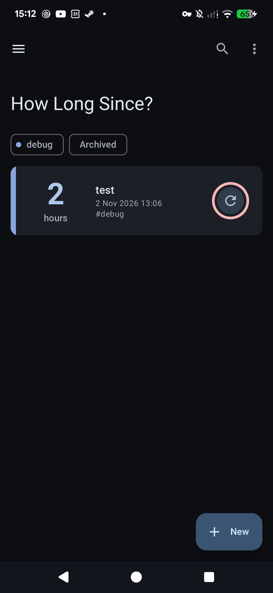
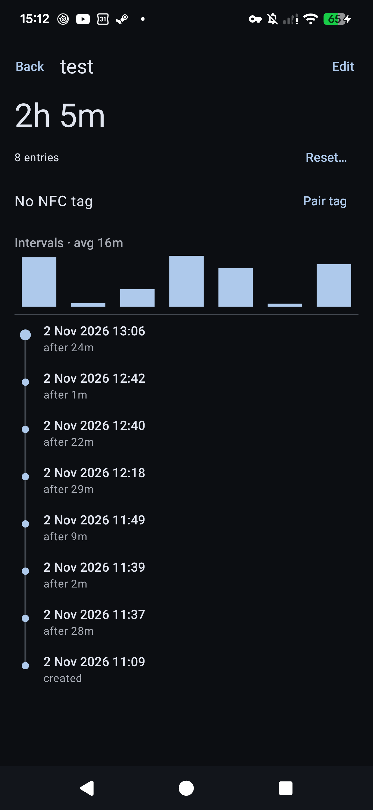
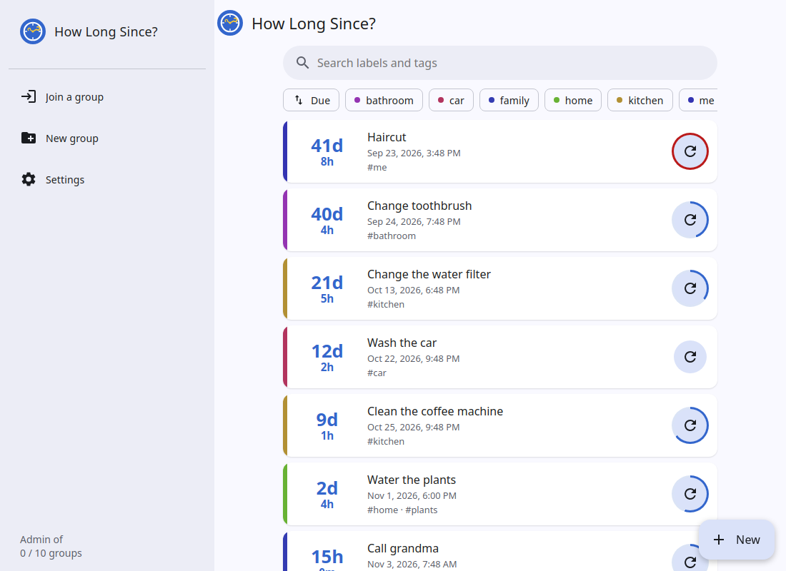

# How Long Since?

**English** | [Italiano](README-IT.md)


A small Android app that tracks how long it has been since something last happened, such as watering the plants, changing the toothbrush or the last haircut.

Each item is a **counter**: a label, some tags, and a log of every time it was set or reset. The app shows the time since the latest reset and can remind you when a counter has gone too long. An NFC sticker can reset a counter with a single tap.

An optional self-hosted server keeps the counters in sync between the phone and a web app that works in any browser.

 

## Features

- **Counters**
  - Each counter has a label and comma-separated tags.
  - Cards show the elapsed time as a large number ("12 days") with the date of the last reset underneath.
- **Reset log**
  - Every create or reset is stored, marked `create`, `manual` or `nfc`.
  - Each counter's detail page shows the log as a timeline, with the gap between resets.
  - A small bar chart shows the recent intervals and their average.
- **Reset at a past time**: "Reset at…" on the detail page, for when you forgot to log it.
- **Notes**: "Reset…" on the detail page takes an optional note (e.g. "new filter brand"), shown in the timeline.
- **Archive**: hide a counter without losing its history; archived counters have no reminders and sit behind an "Archived" chip.
- **Search and sort**: search labels and tags; sort by most overdue, recently reset or name (app and web).
- **Home-screen widget**: the counters most in need of a reset, each with a reset button. Times refresh on every change and every 30 minutes.
- **Use my average**: the edit dialog can set "notify after" to your average interval between resets.
- **Overdue first**: counters past their reminder are listed at the top (app and web).
- **Launcher shortcuts**: long-press the app icon to reset the 4 counters that need it most.
- **Undo**: every reset shows an "Undo" snackbar, and Undo removes that log entry.
- **Reminders**
  - Optionally set "notify after" in hours, days or weeks (or minutes in Debug mode).
  - A ring around the reset button fills up as the reminder time gets closer and turns red when overdue.
  - Tapping the notification opens that counter's page. Its buttons reset the counter or snooze for a day.
- **NFC tags**
  - Pair a tag from the counter's detail page. The app writes `howlongsince://reset/<uuid>` (the counter's sync id, so the tag works on every synced phone) to the tag and remembers the tag's ID.
  - Tapping the tag resets the counter, even when the app is closed.
  - Tags that aren't paired are rejected, and Unpair or Re-pair makes an old tag stop working.
  - Or "Copy URL" and write the tag with any other NFC app; the first tap of that tag then pairs it.

  

- **Tags**: a filter row at the top of the list, with a stable color for each tag.
- **Settings** (☰ menu)
  - Dark theme switch. It follows the system until you change it.
  - Debug mode, which allows minute-based reminders.
  - JSON export, and an import that replaces all data. The file is checked and you confirm before anything is overwritten. With sync on, the import replaces the data on the server too.
  - Sync server URL and token, with the last sync status and a "Sync now" button. Leave the URL empty to turn sync off.
- **Languages**: English and Italian, following the phone or browser language. On Android 13+ the app's language can also be set on its own in the system settings (Settings → Apps → How Long Since? → Language).
- **Look**: Material 3 with colors from your wallpaper (Android 12+) and a large title bar that collapses as you scroll.

## Tech

- Kotlin and Jetpack Compose (Material 3), in a single Activity. Android 8.0 (API 26) or later.
- **Room** stores data in two tables: `Counter` and `Event`. Elapsed time is calculated from the latest `Event` and never stored.
- **WorkManager** runs one delayed job per counter, and it is replaced on every change.
- The **Android NFC API**: NDEF URI records for tapping, and reader mode while pairing.
- The built-in `org.json` library for export, import and sync, and `HttpURLConnection` for sync.

## Code layout

```
app/src/main/java/eu/etrunon/howlongsince/
  Data.kt          Room entities, database queries, time and tag formatting helpers
  MainActivity.kt  List screen, edit dialog, settings, handling of notification and NFC intents
  Detail.kt        Detail screen: timeline, interval chart, NFC pairing
  Notify.kt        Reminder scheduling and the notification worker
  Nfc.kt           Tag writing and reading of the reset URI
  Export.kt        JSON export, import and restore
  Sync.kt          Sync with the server: JSON format and the HTTP call
  Widget.kt        Home-screen widget
  Theme.kt         Dynamic color theme and tag colors
app/src/test/.../SinceTest.kt  Unit tests (formatting, tags, reminder delay, NFC URI, backup and sync JSON round trips)
server/
  main.go          Sync server: merge logic, JSON file storage, HTTP handlers
  main_test.go     Merge unit test (runs during docker build)
  index.html       Web app, built into the server binary
  Dockerfile, compose.yml
logo.svg           Logo (the app icon and the web favicon are drawn from it)
```

## Build

Requires JDK 21 (Gradle 8.11 does not run on newer JDKs) and the Android SDK. Set `sdk.dir` in `local.properties`, or set `ANDROID_HOME`.

```bash
export JAVA_HOME=/usr/lib/jvm/java-21-openjdk-amd64
./gradlew test          # unit tests
./gradlew installDebug  # build and install on a connected phone (USB debugging on)
```

NFC needs a real phone and writable NDEF tags (for example NTAG213/215/216).

## Sync server and web app (optional)

`server/` is a small Go server that stores everything in one JSON file and serves the web app. The Docker image is a single binary of about 8 MB. Each person runs their own copy; the app has no built-in server address.



**Web app**: list of counters with the time since the last reset, sorted by the oldest reset. You can add, reset and delete counters. Opening a counter shows the reset log, the interval chart, and a form for its label, tags and "notify after" reminder (the reminder itself fires on the phone). A paired NFC tag can be unpaired, but pairing needs the phone. The times on the page update every minute.

**Run it**
```bash
cd server
echo HLS_TOKEN=$(openssl rand -hex 16) > .env   # the token clients need
mkdir -p data                                   # must be writable by uid 1000
docker compose up -d --build                    # listens on 127.0.0.1:13387
```
Put a reverse proxy with HTTPS in front of it. The server speaks plain HTTP only; the proxy handles the certificate (Let's Encrypt, your own, …), rate-limits token guessing, and adds browser security headers. nginx does all of this without plugins:
```nginx
# in the http {} block
limit_req_zone $binary_remote_addr zone=hls:1m rate=30r/m;

server {
    listen 443 ssl;
    server_name hls.example.com;
    ssl_certificate     /etc/letsencrypt/live/hls.example.com/fullchain.pem;
    ssl_certificate_key /etc/letsencrypt/live/hls.example.com/privkey.pem;

    add_header Strict-Transport-Security "max-age=31536000" always;
    add_header X-Content-Type-Options nosniff always;
    add_header Referrer-Policy no-referrer always;
    add_header Content-Security-Policy "default-src 'self'; script-src 'self' 'unsafe-inline'; style-src 'self' 'unsafe-inline'; frame-ancestors 'none'" always;

    location /sync {
        limit_req zone=hls burst=20 nodelay;   # ~30 syncs/min per IP, bursts allowed
        proxy_pass http://127.0.0.1:13387;
    }
    location / {
        proxy_pass http://127.0.0.1:13387;
    }
}
```
With Caddy, the same headers go in a `header` block; rate limiting needs the `caddy-ratelimit` plugin. `tailscale serve` gives HTTPS but can't add headers or limits, which is fine when only your tailnet can reach it.

The Android app needs an `https://` URL with a certificate that Android trusts by default (Let's Encrypt, Tailscale, a commercial CA). Self-signed or private-CA certificates installed on the phone are not trusted by the app.

Then:
- **Web**: open the URL and log in with the token. The login form works with password managers, and the token is then kept in the browser.
- **Install the web app** (own window, own icon):
  - Chrome / Chromium / Edge (any OS): the install icon on the right of the address bar.
  - Firefox on Windows (143+): the "add to taskbar" icon in the address bar pins it to the Windows taskbar. If missing, set `browser.taskbarTabs.enabled` to `true` in `about:config`.
  - Firefox on Android: menu → "Add to Home screen".
  - Firefox on Linux: no install option; use a pinned tab or Chromium.
- **Phone**: Settings → Sync server, enter the URL and the token.

**Configuration** (environment variables): `TOKEN` (bearer token, required: the server won't start without it), `INSECURE=1` (run without a token, only on a trusted network), `DATA_FILE` (default `/data/data.json`), `ADDR` (default `:8080`). `compose.yml` maps `HLS_TOKEN` from `.env` to `TOKEN`.

**API**: `GET /` web app, `GET /health` returns `ok`, `POST /sync` takes `{counters, events}` (all or only the changed ones) and returns the merged full state.

**How sync works**
- Counters and resets have a UUID for sync. The phone keeps its local ids for reminders; NFC tags hold the UUID.
- Counter edits: the newer `updatedAt` wins. Resets are merged by id.
- Deletes are tombstones (`deleted: true`), so they reach every device.
- The app sends everything when it opens, shortly after every change, and every 15 minutes in the background (the Android minimum), then applies the merged result. The web app syncs every 15 minutes and when its tab comes back into view.
- Deleted counters are dropped for good after 90 days, on the server and the phone. A device that has been offline for longer could bring one back.
- Responses are gzipped. The web app can be installed as an app (manifest + icon).
- The server drops slow or stuck connections (10 s to send headers, 30 s per request).
- The server writes the file atomically and refuses to start if it is corrupt, rather than overwriting it.

**Several phones on one server**
- Every phone (and browser) with the token shares one dataset, which suits a household sharing chores. For separate people, run one container per person on its own port.
- Resets are never lost: each has a UUID and the server keeps them all, even when two phones reset at the same moment.
- Edits are whole-counter: the newer `updatedAt` replaces label, tags and reminder together, so two people changing different fields at almost the same time lose one change.
- Edit order uses each phone's clock; a phone whose clock is off by minutes can win or lose an edit it shouldn't.
- Reminders fire on every phone that has the counter. A tag paired on one phone works on all of them: the tag holds the counter's sync id, and the pairing syncs.
- The server handles one sync at a time, and each sync carries the full state, which is fine for a few phones and hundreds of counters (requests are capped at 10 MB).

## License

GPL-3.0, see [LICENSE](LICENSE). You can use, change and share it; shared changes must stay under the GPL.
